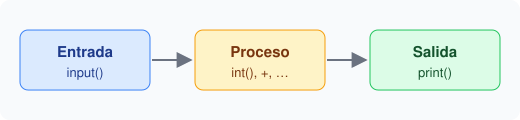

# 1. Entrada y salida

Un programa suele **leer** datos, **procesarlos** y **mostrar** un resultado.



```python
nombre = input()
print("Hola,", nombre)
```

- `input()` lee una línea y la devuelve como **texto** (`str`).
- `print()` muestra valores en pantalla.
- Para operar con números convierte con `int()` o `float()`.
